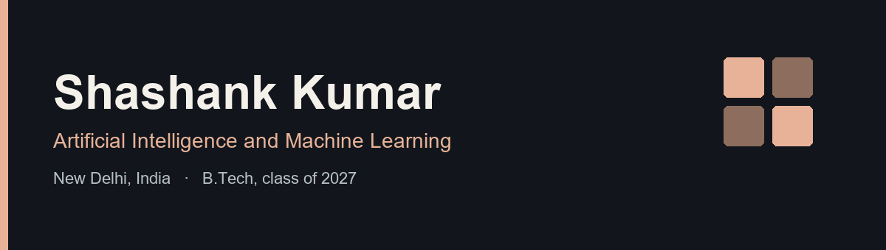

  

  <a href="https://shashankumar11.github.io">Portfolio</a> ·
  <a href="https://www.linkedin.com/in/shashank-kumar-379266315">LinkedIn</a> ·
  <a href="mailto:shashankusar11@gmail.com">shashankusar11@gmail.com</a>

I am a B.Tech student in Artificial Intelligence and Machine Learning at the University School of Automation and Robotics, graduating in 2027. I train classification models, build prompt-based tools for extraction and question answering, and have evaluated a YOLOv8 detection pipeline on underwater images.

## Selected work

| Project | What it is |
| --- | --- |
| [Portfolio](https://shashankumar11.github.io) | Site for experience, projects, and contact. |
| [Personality Prediction](https://github.com/Shashankumar11/personality-prediction) | Logistic regression on behavioral data, with encoding, scaling, and ANOVA feature analysis. |
| [LLM Data Extraction Assistant](https://github.com/Shashankumar11/llm-data-extraction-assistant) | Turns CSV, JSON, and log files into structured fields. |
| [Domain Q&A Chatbot](https://github.com/Shashankumar11/domain-qa-chatbot) | Machine-learning chatbot that keeps conversation history and stays on topic. |

## Experience

- **Research intern, IIT Tirupati** — YOLOv8 pipeline for underwater object detection, including image preprocessing and evaluation on real scenes.
- **Data science intern, Australian Institute of Advanced Technologies** — coached students on data preparation, model choice, and how results were evaluated.

## Toolbox

Python · SQL · Pandas · NumPy · Scikit-learn · PyTorch · TensorFlow · YOLOv8 · Flask · Git

Open to data science and AI/ML apprentice roles.
